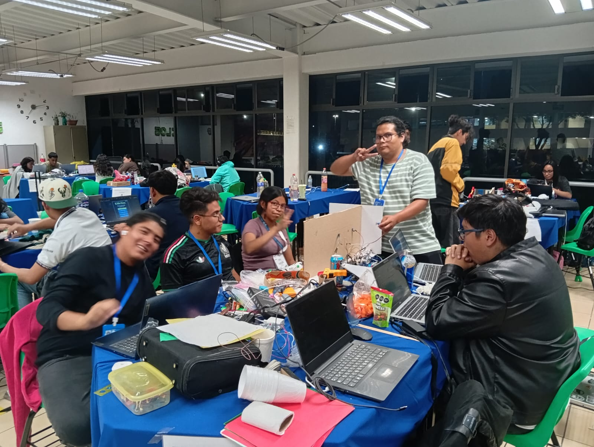

# CooLogix

Prototipo de banda transportadora con adquisición de datos, telemetría y control. Desarrollado por **Los 5 Fantásticos**, TecNM Campus Tláhuac.

**Estado:** prototipo presentado en el HackaTec Regional 2026, en el reto de Tecnologías Emergentes.

## Problema y solución

La supervisión manual de una banda dificulta detectar interrupciones y comprobar cuándo pasa un producto. El equipo construyó una maqueta para demostrar cómo añadir detección, control y monitoreo web a una línea existente.

## Funcionamiento

1. Los sensores TCRT5000 detectan el paso de un producto en la banda.
2. El ESP32 procesa las lecturas y coordina el accionamiento del motor mediante el L298N y el movimiento de una compuerta mediante un servomotor.
3. La interfaz web muestra los datos del proceso y permite supervisar el estado de la banda. El equipo probó la detección y las acciones de control sobre la maqueta.

## Tecnologías

ESP32 y Arduino IDE para el control, TCRT5000 para la detección, L298N y servomotor para la actuación, Proteus para simulación e interfaz web para el monitoreo.

## Mi contribución

Propuse la idea original. Participé en la construcción, el cableado y la integración electrónica de la maqueta. Programé el ESP32 y colaboré en la integración del software de monitoreo y las pruebas del conjunto.

## Resultados

El equipo integró el sistema físico y la interfaz para su presentación regional. La incorporación por módulos en una línea real formó parte de la propuesta de implementación.

## Montaje en el HackaTec Regional

Ensamblaje de la maqueta y conexiones electrónicas durante el HackaTec Regional.
